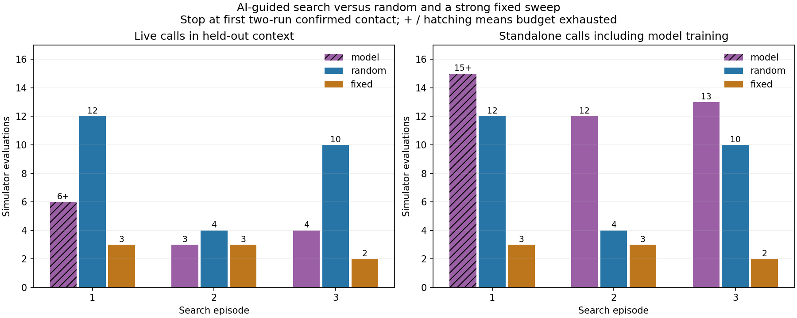

# Robot Failure Lab 07: AI-guided failure search

56 oracle evaluations comparing GP-guided, fixed and random test selection; the fixed sweep was strongest in this bounded pilot.

Experiment date: **2026-10-20**. These are exploratory simulation/component results, not physical-robot validation or a general reliability benchmark. Fresh-machine reproduction remains unverified.

## Results and reproduction

- [Measured report](evidence/REPORT.md)
- [Findings and limitations](evidence/FINDINGS.md)
- [Reproduction instructions](evidence/reproduction/README.md)
- [Import provenance and timestamps](PUBLICATION.md)

Use Ubuntu 24.04 / WSL2, Python 3.12 and ROS 2 Jazzy. Navigation experiments additionally require Nav2, Gazebo and the packages listed with the evidence. Report generation uses NumPy, matplotlib, Pillow and PyYAML. Retained package/version records describe the measured environment.

From this repository, change into `evidence/reproduction` before following the reproduction commands. Always write new runs to a new directory; the included evidence must remain unchanged.

## Related experiments

- [Lab 01: Laser-scan delay](https://github.com/nahid633/robot-failure-lab-01-scan-delay)
- [Lab 02: Two-second scan blackout](https://github.com/nahid633/robot-failure-lab-02-scan-blackout)
- [Lab 03: Preserving localization input](https://github.com/nahid633/robot-failure-lab-03-localization-feed)
- [Lab 04: Goal tolerance and arrival acceptance](https://github.com/nahid633/robot-failure-lab-04-goal-tolerance)
- [Lab 05: Live topics, frozen observations](https://github.com/nahid633/robot-failure-lab-05-frozen-scans)
- [Lab 08: Component replay fidelity](https://github.com/nahid633/robot-failure-lab-08-replay-fidelity)

## Reuse

Upstream copyright and license notices remain in the archived source. See [third-party notices](THIRD_PARTY_NOTICES.md). No new blanket license is assigned to original experiment code or evidence by this import.
